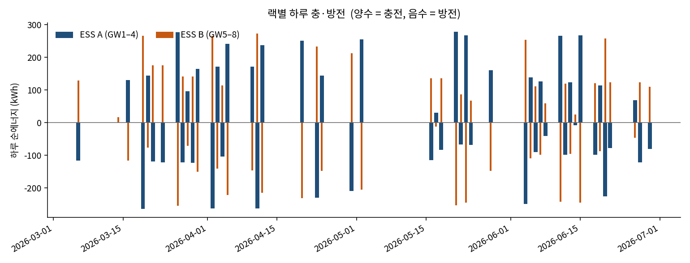
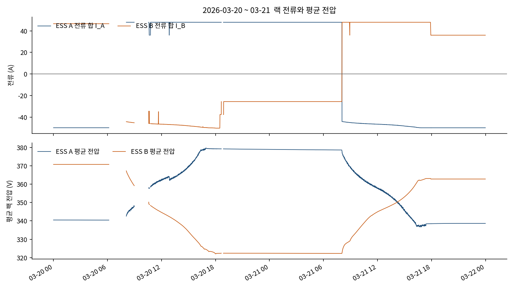
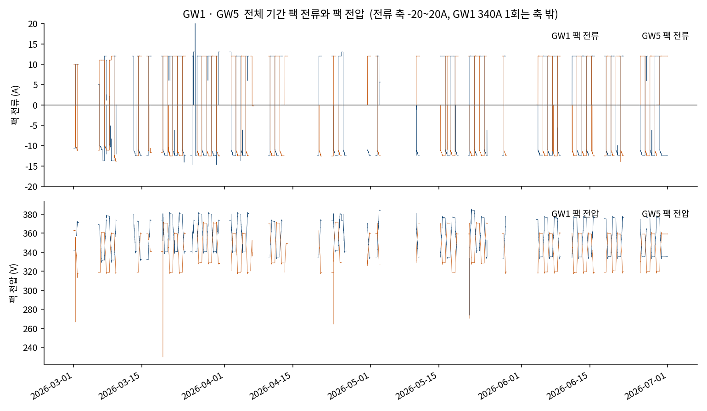
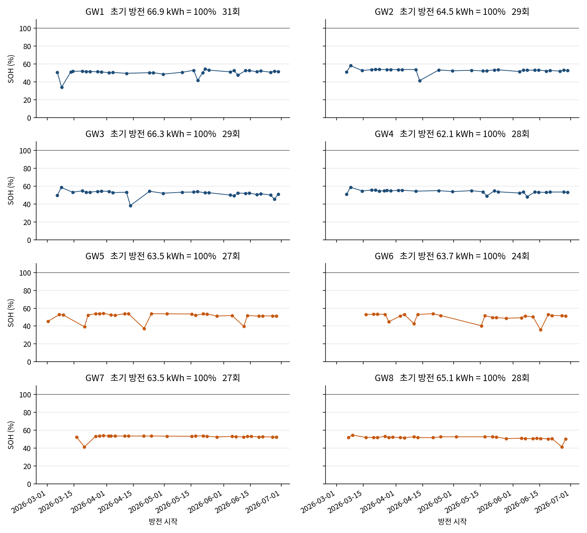
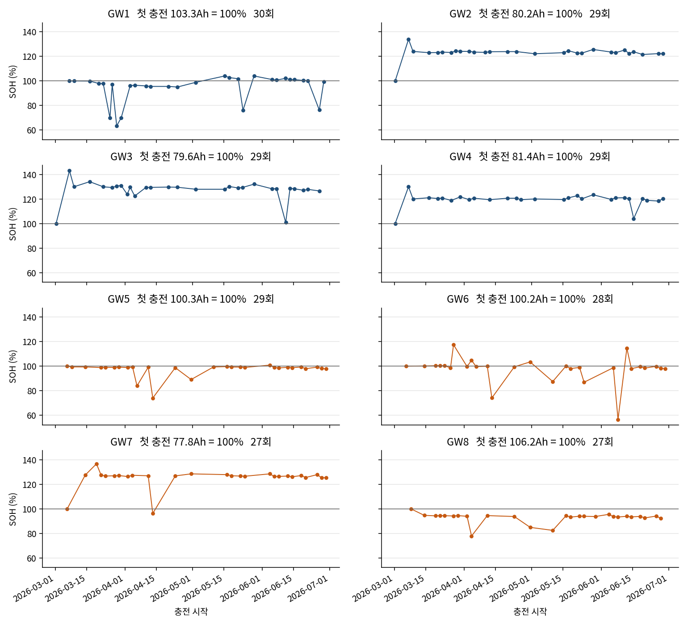
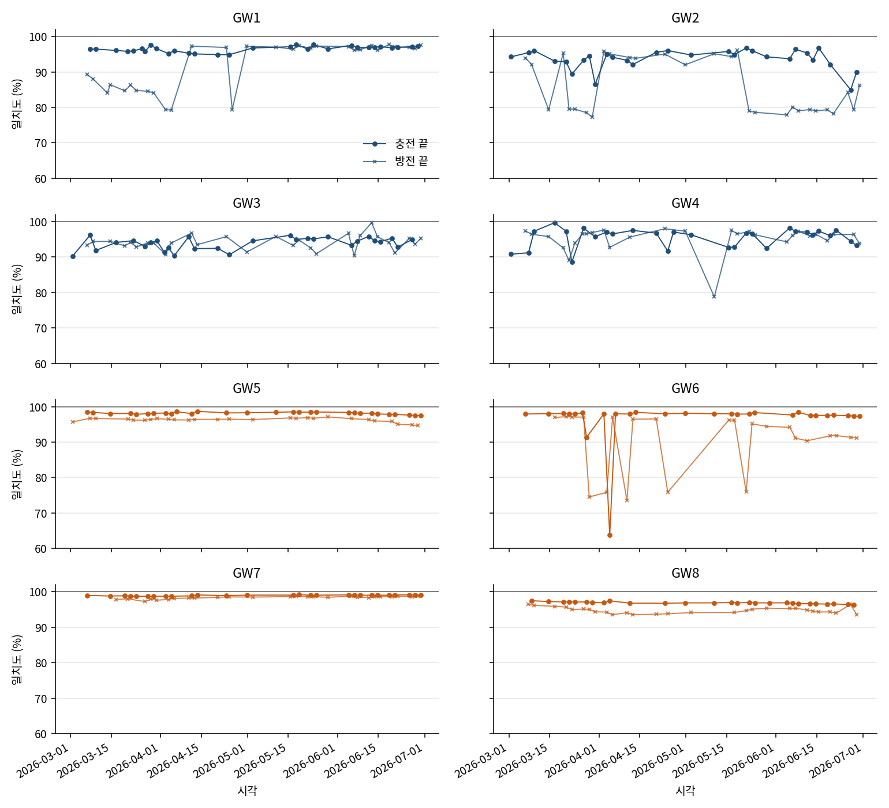

# 사용후 배터리 ESS 전처리

## 개요

- 기간: 2026-03-01 ~ 2026-06-30
- 구성: ESS 2대, DC-DC로 서로 충·방전
- ESS A: GW1, GW2, GW3, GW4
- ESS B: GW5, GW6, GW7, GW8
- GW 1개: 모듈 5개. 셀 전압·저항·온도가 한 줄에 함께 있음
- 전류 양수: 그 GW로 충전. 한쪽이 충전되면 다른 쪽은 거의 항상 방전
- 기본 간격: 30초
- 원본 칸 수: 235개
  - 시각 1, 팩 전류 1, 팩 전압 1
  - 셀 전압 100 (모듈 5 × 셀 20)
  - 셀 저항 100 (모듈 5 × 셀 20)
  - 모듈 온도 20 (모듈 5 × 온도계 4)
  - 환경 12 (냉각온도 2, CO2 1, TVOC 1, 함체 온도 4, 습도 4)
- 전처리 파일 칸 수: 235개. 값이 전부 0인 환경 10칸(CO2, TVOC, 함체 온도, 습도)을 빼고, 품질 표시 7칸과 식별 3칸(GW, ESS, 파일명)을 넣음
  - 유지: 시각 1, 팩 전류 1, 팩 전압 1, 셀 전압 100, 셀 저항 100, 모듈 온도 20, 냉각온도 2

## 데이터 규모

- 122일 중 원본 파일이 있는 날: 67일
- 원본: CSV 505개, 약 2.23GB, 1,467,117줄
- 전처리 후: 475개 파일, 1,291,741줄
- 저장 용량: `clean` 약 197MB, `aligned` 약 4.4MB
- 모듈 5개는 별도 줄이 아님. 줄 수는 GW 기준
- 모듈당 셀 20칸, 온도계 4개
- 원본 줄 수가 다른 이유: 주기 차이와 빠진 줄이 둘 다 있음
- 주기: 2026-03-01만 GW1·GW2·GW5가 1초. 같은 날은 30초면 약 2,880줄인데, 1초 기록은 3.2만~3.4만 줄. 나머지 날과 나머지 GW는 30초
- 1초인 3월 1일도 하루가 가득 차지 않음. 첫 줄과 마지막 줄 사이에 GW1 53,453초, GW2 52,440초, GW5 53,940초가 비어 있음
- GW1 2개 파일, GW4 1개 파일은 시각이 분 단위지만 줄 간격은 30초. 주기 차이는 아님
- 30초 기록의 줄 수 차이: 파일이 없는 날, 하루 중간 공백, 0시보다 늦게 시작하거나 24시 전에 끝난 날이 섞여 있음
- 중간 공백: 그 파일의 첫 시각과 끝 시각 사이에 30초 칸이 비어 빠진 줄. 1초 파일의 빈 초는 넣지 않음
- 짧은 기록: 00:00~23:59를 30초로 채우면 2,880줄. 그보다 늦게 시작하거나 일찍 끝나 없는 줄
- 위 내용은 원본 줄 수. 같은 랙 안에서 전처리 후 줄 수가 다른 이유는 다음 절

| GW | ESS | 원본 파일 | 원본 크기 | 원본 줄 수 | 1초 줄 | 30초 줄 | 중간 공백 | 짧은 기록 | 남긴 운행일 | 남긴 줄 수 |
|---|---|---:|---:|---:|---:|---:|---:|---:|---:|---:|
| GW1 | A | 66 | 316MB | 207,537 | 32,965 | 174,572 | 1,982 | 10,866 | 62일 | 165,308 |
| GW2 | A | 63 | 320MB | 209,457 | 33,962 | 175,495 | 57 | 2,966 | 60일 | 169,725 |
| GW3 | A | 62 | 255MB | 167,419 | 0 | 167,419 | 1,758 | 9,356 | 59일 | 158,757 |
| GW4 | A | 62 | 252MB | 166,784 | 0 | 166,784 | 2,574 | 9,179 | 61일 | 164,947 |
| GW5 | B | 63 | 301MB | 198,110 | 32,458 | 165,652 | 2,921 | 10,955 | 61일 | 161,742 |
| GW6 | B | 63 | 259MB | 170,672 | 0 | 170,672 | 3,484 | 7,256 | 57일 | 154,045 |
| GW7 | B | 63 | 273MB | 178,661 | 0 | 178,661 | 2,118 | 625 | 54일 | 153,400 |
| GW8 | B | 63 | 256MB | 168,477 | 0 | 168,477 | 3,636 | 9,302 | 61일 | 163,817 |

- ESS A: 658,737줄, 운행 65일
- ESS B: 633,004줄, 운행 63일
- GW 중 하나라도 남은 날: 66일
- GW 8개가 동시에 있는 기록: 108,360줄, 49일

## 같은 랙인데 줄 수가 다른 이유

- 랙은 하나고, 저장 파일은 GW마다 따로 있음
- 겹치는 시각의 전류는 같이 움직이고, 줄 수는 기록 길이에 따라 다름
- 차이는 두 종류. 하루 전체가 있는 GW가 다름. 같은 날도 기록 길이가 다름

### 하루 전체가 다른 경우

- ESS A: 한 GW라도 남은 날 65일. 네 GW가 모두 있는 날 56일
- ESS B: 한 GW라도 남은 날 63일. 네 GW가 모두 있는 날 53일

| 날짜 | 랙 | 남은 GW | 없는 GW | 이유 |
|---|---|---|---|---|
| 03-13 | A | GW1 | GW2, GW3, GW4 | 파일 없음 |
| 03-25 | A | GW1 | GW2, GW3, GW4 | 파일 없음 |
| 04-06 | A | GW4 | GW1, GW2, GW3 | 4월 2일과 값이 같아 제외 |
| 04-13 | A | GW2, GW3, GW4 | GW1 | 4월 4일과 값이 같아 제외 |
| 04-25 | A | GW1, GW4 | GW2, GW3 | GW2는 4월 13일, GW3는 4월 4일과 값이 같아 제외 |
| 04-26 | A | GW4 | GW1, GW2, GW3 | GW1·GW3는 4월 10일, GW2는 4월 12일과 값이 같아 제외 |
| 06-25 | A | GW1, GW2, GW3 | GW4 | 내용은 2024-11-25 |
| 06-28 | A | GW1, GW2, GW4 | GW3 | 파일 없음 |
| 06-30 | A | GW1, GW2, GW3 | GW4 | 파일 없음 |
| 03-01 | B | GW5 | GW6, GW7, GW8 | GW6·GW7은 서로 값이 같아 제외. GW8 내용은 2024-08-01 |
| 03-07 | B | GW5, GW8 | GW6, GW7 | 서로 값이 같아 제외 |
| 03-08 | B | GW5, GW8 | GW6, GW7 | 서로 값이 같아 제외 |
| 03-09 | B | GW5, GW8 | GW6, GW7 | 서로 값이 같아 제외 |
| 03-22 | B | GW5, GW6, GW8 | GW7 | 3월 1일 GW6·GW7과 값이 같아 제외 |
| 04-06 | B | GW5, GW6, GW8 | GW7 | 4월 2일과 값이 같아 제외 |
| 04-25 | B | GW8 | GW5, GW6, GW7 | GW5는 4월 4일, GW6·GW7은 4월 2일과 값이 같아 제외 |
| 05-10 | B | GW5, GW6, GW8 | GW7 | 내용은 2024-10-10 |
| 05-15 | B | GW5, GW6, GW7 | GW8 | 파일 없음 |
| 05-29 | B | GW8 | GW5, GW6, GW7 | 파일 없음 |

### 같은 날인데 길이가 다른 경우

- 시작 시각, 종료 시각, 중간 공백이 GW마다 다름
- ESS A: 네 GW가 같이 있는 56일 중 51일의 줄 수가 다름. 차이 중앙값 124줄. 가장 큰 날은 6월 21일, GW2 1,257줄, GW1·GW3 2,879줄
- ESS B: 53일 중 47일의 줄 수가 다름. 차이 중앙값 11줄. 가장 큰 날은 3월 6일, GW8 1,028줄, GW5·GW6 2,879줄
- 각 GW가 가진 날만 30초 하루 2,880줄로 채워도 날 수가 달라 줄 수는 아래처럼 남음

| GW | ESS | 남긴 날 | 하루를 2,880줄로 채운 줄 수 |
|---|---|---:|---:|
| GW1 | A | 62 | 178,560 |
| GW2 | A | 60 | 172,800 |
| GW3 | A | 59 | 169,920 |
| GW4 | A | 61 | 175,680 |
| GW5 | B | 61 | 175,680 |
| GW6 | B | 57 | 164,160 |
| GW7 | B | 54 | 155,520 |
| GW8 | B | 61 | 175,680 |

- 같은 줄 수가 되려면 시각 격자를 하나로 고정해야 함. 누군가 남은 66일이면 GW마다 190,080줄. 3월 1일~6월 30일 122일이면 GW마다 351,360줄
- 그때도 시각만 같고, 파일이 없는 날의 측정값은 없음

## 파일 위치

- 원본, 전처리 결과는 git 밖. GitHub에는 코드만 있음
- 결과 폴더 이름: `preproced_data`
- 옵션 없이 `python preprocess.py` 실행 시 아래 결과 경로에 저장

| 구분 | 경로 |
|---|---|
| 원본 CSV | `/data1/ess_data/battery_data` |
| 전처리 결과 | `/data1/ess_data/preproced_data` |

## 분석

- 실행 위치: `ess_used_battery`
- 전처리 결과 `clean/`, `aligned/`가 있어야 한다. 없으면 `python preprocess.py`

### 1. 랙 충·방전

```bash
python plot_racks.py
```

- 출처: `aligned/ess_pair.parquet` (30초, 전류 부호는 원본과 같음)
- `I_A`, `I_B`: GW 4개 전류 합. 양수 충전, 음수 방전
- `Vmean_A`, `Vmean_B`: 팩 전압 평균. 충전 시 상승
- `P_A`, `P_B`: 랙 전력(W). 하루 에너지(kWh) 계산에 사용
- 8개가 같이 있는 49일 중 48일, 두 랙 방향이 반대
- 파란 막대: ESS A. 주황 막대: ESS B. 0보다 위가 충전



- 예시 구간: 2026-03-20 ~ 03-21
- 3월 20일: A 약 +48A, 전압 340V → 380V. B 약 -50A, 전압 370V → 322V
- 3월 21일 아침: 방향이 반대
- 선이 끊긴 곳: 기록이 비어 있는 구간



- GW1(ESS A)과 GW5(ESS B) 팩 전류 `total_current`, 팩 전압 `total_voltage`
- 기간: 각 GW의 전체 기록. 같이 있는 150,720줄에서 전류 상관 -0.97, 전압 상관 -0.91
- 전류 축은 -20~20A. GW1의 340A 한 번은 축 밖에 있음
- 파랑: GW1. 주황: GW5. 끊긴 선은 기록 공백



### 2. 방전별 SOH

```bash
python soh_charge.py
```

- 이 명령은 방전 SOH와 충전 SOH를 함께 만든다
- 기준: 검증 시험의 팩별 방전 전력량. 표의 초기용량 합계 515.770 kWh는 방전 전력량 합
- 배터리팩 번호는 GW 번호와 같음. GW1~4는 EV용 충전용 ESS, GW5~8은 수요관리형 ESS
- 공식: `SOH = E / E0 × 100`
- `E0`: 아래 표의 방전 전력량(kWh). `E`: 이번 방전에서 쌓인 에너지(kWh)
- `E = Σ(|전류| × 팩전압 × 시간 간격) / 3,600,000`. 전류가 음수인 방전만 사용
- 방전 구간: 팩 전류가 -5A보다 작은 상태가 이어진 구간
- 10분을 넘는 공백, 전류 스파이크, 팩 전압 끊김이 있으면 구간을 나눔
- 전압이 그 구간 최저값의 1.5V 안에 처음 들어온 시각까지만 더함. 전압이 이미 내려간 뒤 전류만 이어지는 시간은 에너지에서 뺌
- 전압 하강이 25V보다 작으면 방전 횟수에서 뺌
- 표의 충방전 효율: 방전 515.770 / 충전 536.381 × 100 = 96.157%. 이 값은 시험표의 효율이고, SOH 분모는 방전 전력량
- 입력: `clean/GW1.parquet` … `GW8.parquet`의 팩 전류, 팩 전압
- 방전 목록: `soh_by_discharge.csv`

| 팩 | GW | ESS | 시험 충전 (kWh) | 초기 방전 E0 (kWh) |
|---|---|---|---:|---:|
| 1 | GW1 | A | 69.644 | 66.915 |
| 2 | GW2 | A | 67.289 | 64.461 |
| 3 | GW3 | A | 68.761 | 66.309 |
| 4 | GW4 | A | 64.354 | 62.126 |
| 5 | GW5 | B | 66.290 | 63.532 |
| 6 | GW6 | B | 66.610 | 63.733 |
| 7 | GW7 | B | 65.789 | 63.549 |
| 8 | GW8 | B | 67.644 | 65.145 |
| 합계 | | | 536.381 | 515.770 |



- 파랑: ESS A. 주황: ESS B. 가로선: 시험 초기용량 100%
- 현장 방전은 전압이 약 40V 내려갈 때까지 약 33~35 kWh. 시험 초기용량 62~67 kWh보다 구간이 좁아 SOH 중앙값은 51~54
- 3월과 6월이 비슷하고, 100을 넘는 방전은 없음

| GW | ESS | 방전 수 | 에너지 중앙값 (kWh) | SOH 중앙값 | 마지막 SOH | 최소 SOH |
|---|---|---:|---:|---:|---:|---:|
| GW1 | A | 31 | 34.3 | 51.2 | 51.7 | 34.1 |
| GW2 | A | 29 | 34.3 | 53.2 | 52.7 | 41.5 |
| GW3 | A | 29 | 34.9 | 52.6 | 51.0 | 38.2 |
| GW4 | A | 28 | 33.6 | 54.1 | 53.0 | 48.2 |
| GW5 | B | 27 | 33.2 | 52.3 | 51.1 | 37.4 |
| GW6 | B | 24 | 32.9 | 51.6 | 51.4 | 35.8 |
| GW7 | B | 27 | 33.9 | 53.4 | 52.4 | 41.5 |
| GW8 | B | 28 | 33.8 | 51.9 | 50.1 | 41.6 |

- 40 아래로 내려간 점은 그 방전에서 전압이 덜 내려가 에너지가 작음. GW1 3월 8일 34.1, GW6 6월 15일 35.8

### 3. 충전별 SOH

```bash
python soh_charge.py
```

- 2번과 같은 명령이다. 전류가 양수인 충전 구간만 이 절의 대상이다
- 공식: `SOH = E / E0 × 100`
- `E0`: 위 표의 시험 충전 전력량(kWh). GW1은 69.644, GW4는 64.354, GW8은 67.644
- `E`: 이번 충전에서 쌓인 에너지(kWh). `E = Σ(전류 × 팩전압 × 시간 간격) / 3,600,000`
- 충전 구간: 팩 전류가 5A보다 큰 상태가 이어진 구간
- 10분을 넘는 공백, 전류 스파이크, 팩 전압 끊김이 있으면 구간을 나눔
- 전압이 그 구간 최대값의 1.5V 안에 처음 들어온 시각까지만 더함. 전압이 이미 오른 뒤 전류만 이어지는 시간은 에너지에서 뺌
- 전압 상승이 25V보다 작으면 충전 횟수에서 뺌
- 충전 목록: `soh_by_charge.csv`



- 파랑: ESS A. 주황: ESS B. 가로선: 시험 충전 전력량 100%
- 현장 충전은 전압이 약 40V 오를 때까지 약 34~37 kWh. 시험 충전 64~70 kWh보다 구간이 좁아 SOH 중앙값은 51~54
- 3월과 6월이 비슷하고, 100을 넘는 충전은 없음

| GW | ESS | 충전 수 | 에너지 중앙값 (kWh) | SOH 중앙값 | 마지막 SOH | 최소 SOH |
|---|---|---:|---:|---:|---:|---:|
| GW1 | A | 30 | 36.6 | 52.6 | 52.7 | 33.6 |
| GW2 | A | 29 | 35.6 | 53.0 | 52.6 | 42.6 |
| GW3 | A | 29 | 36.7 | 53.4 | 52.2 | 41.4 |
| GW4 | A | 29 | 34.9 | 54.2 | 53.9 | 45.0 |
| GW5 | B | 29 | 34.0 | 51.3 | 50.7 | 37.8 |
| GW6 | B | 28 | 34.2 | 51.4 | 51.1 | 27.8 |
| GW7 | B | 27 | 34.8 | 52.9 | 52.4 | 39.7 |
| GW8 | B | 27 | 34.7 | 51.2 | 50.4 | 42.0 |

- 40 아래로 내려간 점은 그 충전에서 전압이 덜 올라 에너지가 작음. GW1 3월 28일 33.6, GW6 6월 8일 27.8

### 4. 셀 전압 일치도

```bash
python cell_consistency.py
```

- SOC, SOH와 별개. 같은 시각의 셀 전압이 서로 얼마나 모여 있는지로 팩 성능을 본다
- 시점: 충전은 팩 전압이 그 구간 최대의 1.5V 안에 처음 들어온 시각. 방전은 최저의 1.5V 안
- 전류 조건은 충전·방전 SOH와 같음. 5A보다 큰 충전, -5A보다 작은 방전. 전압 변화 25V 미만은 제외
- 유효 셀: 0.5V 초과 4.5V 미만. 비활성 칸은 전처리에서 이미 결측
- 불균일률(%) = `(최대 셀 − 최소 셀) / 셀 중앙값 × 100`
- 일치도(%) = `100 − 불균일률`. 유효 셀 전압이 모두 같으면 100
- 셀 이탈률(%) = `(그 셀 − 셀 중앙값) / 셀 중앙값 × 100`. 음수면 중앙보다 낮음
- 회차별 목록: `cell_consistency.csv`



- 점: 충전 끝. 가위표: 방전 끝. 파랑: ESS A. 주황: ESS B. 가로선: 100%

| GW | ESS | 충전 일치도 | 방전 일치도 | 3월 방전 | 6월 방전 | 방전 때 가장 자주 낮은 셀 | 그 셀 이탈률 |
|---|---|---:|---:|---:|---:|---|---:|
| GW1 | A | 96.6 | 96.3 | 84.8 | 97.0 | 1모듈 11셀 | -14.4 |
| GW2 | A | 94.3 | 80.1 | 79.5 | 79.3 | 1모듈 8셀 | -19.2 |
| GW3 | A | 94.5 | 94.0 | 94.0 | 95.3 | 4모듈 15셀 | -4.5 |
| GW4 | A | 96.6 | 96.4 | 96.4 | 96.0 | 2모듈 15셀 | -2.6 |
| GW5 | B | 98.2 | 96.4 | 96.4 | 95.8 | 4모듈 11셀 | -2.3 |
| GW6 | B | 97.9 | 94.2 | 97.1 | 91.4 | 3모듈 13셀 | -7.2 |
| GW7 | B | 99.0 | 98.5 | 97.8 | 98.7 | 5모듈 11셀 | -0.8 |
| GW8 | B | 96.9 | 94.6 | 95.4 | 94.5 | 2모듈 10셀 | -3.3 |

- 숫자는 중앙값(%). 이탈률은 그 셀이 최저였던 회의 중앙값
- 가장 고른 팩은 GW7. 충전 99.0, 방전 98.5
- 가장 벌어진 팩은 GW2 방전. 일치도 80.1. 1모듈 8셀이 29회 중 17회 최저이고, 그때 중앙값보다 19.2% 낮다
- GW1 방전은 3월 84.8에서 6월 97.0으로 모였다. 3월에 1모듈 11셀이 낮았다
- GW6 방전은 3월 97.1에서 6월 91.4로 벌어졌다
- 충전 끝에서 셀 전압 합과 팩 전압의 차이는 GW1·GW3·GW6·GW7·GW8이 0.03V 안쪽. GW4는 -0.8V, GW5는 +3.7V, GW2는 -7.8V. 일치도는 팩 전압이 아니라 셀 중앙값 기준이다

## 전처리 실행

```bash
pip install -r requirements.txt
python preprocess.py
```

- 실행 위치: `ess_used_battery`

- 경로를 직접 지정할 때

```bash
python preprocess.py \
  --raw /data1/ess_data/battery_data \
  --out /data1/ess_data/preproced_data
```

## 전처리 개요

- 원본 형식: GW별, 날짜별 CSV 1개

### 읽기

- 깨진 칸 이름(`vol_cell_1_3.1` 등)은 무시하고 칸 순서로 읽음
- 순서: 시각, 팩 전류, 팩 전압, 셀 전압 100, 셀 저항 100, 모듈 온도 20, 냉각온도 2
- 제외: CO2, TVOC, 함체 내부온도 4, 습도 4 (전부 0)
- 시각 앞 작은따옴표 제거

### 시간

- 결과를 30초 간격으로 통일
- 1초 기록 3개(`GW1`, `GW2`, `GW5`의 2026-03-01): 30초 평균
- 초가 없는 3개(`GW1` 3/13, `GW1` 4/25, `GW4` 4/26): 순서대로 0초, 30초 부여
- 시험하지 않은 날은 빈 줄을 만들지 않음

### 제외한 파일

- 사유 목록: `reports/file_manifest.csv`
- 파일명은 2026년, 내용은 2024년 3개: `GW4_20260625`, `GW7_20260510`, `GW8_20260301`
- 측정값이 같은 복사본 27개
  - 같은 GW: 더 이른 날짜만 유지
  - 다른 GW끼리 동일: 묶음 전체 제외 (3/1, 3/7, 3/8, 3/9, GW7 3/22)
  - 목록: `reports/duplicate_groups.csv`
- `GW6_20260406`: 4/2와 거의 같으나 일부 행이 달라 유지

### 센서와 표시

- 이상값은 삭제하지 않고 결측으로 바꾼 뒤 표시. 이후 이상 탐지에 사용
- 냉각온도 -40 미만 또는 1000 초과: 결측. A는 거의 전부 해당, B는 유효
- 셀 온도 -40 미만: 결측
- 하루의 80% 이상이 0인 칸: 빈 슬롯. 주로 2번·3번 모듈 20번. 목록 `reports/inactive_slots.csv`
- 셀이 있는 칸의 전압 0: 결측, `flag_cell_zero`
- 셀 전압 0 초과 2.5V 미만: 값 유지, `flag_low_cell` (GW6 모듈 2, 약 2.4V 구간)
- 팩 전압 200V 미만: 결측, `flag_pack_dropout`
- 셀 전압 합과 팩 전압 차이 5V 초과: `flag_vsum_mismatch`. GW2는 약 72%라 이 표시만으로 행을 지우면 안 됨
- 30초 안 전류 절대값 20A 초과: `flag_current_spike`. GW1만 해당, 최대 340A. 평소는 약 ±15A
- 이전 줄과 10분 초과: `flag_gap`, `gap_before_s`. 이 구간을 넘어 전류를 더하지 않음
- 10분 이상 공백: GW마다 21~29곳. 가장 긴 공백은 GW7 약 288시간

## 결과 파일

- 위치: `/data1/ess_data/preproced_data`

| 파일 | 내용 |
|---|---|
| `clean/GW1.parquet` … `GW8.parquet` | GW별 30초 기록. `ess`는 A 또는 B |
| `aligned/ess_pair.parquet` | 8개 GW가 동시에 있는 시각. `I_A`, `I_B`, 평균 전압, `P_A`, `P_B` |
| `reports/file_manifest.csv` | 파일별 남김 / 복사본 제외 / 날짜 불일치 |
| `reports/duplicate_groups.csv` | 복사본 묶음 |
| `reports/inactive_slots.csv` | 비어 있는 셀 칸 |
| `reports/summary.json` | 줄 수, 두 ESS 맞춤 결과 |

- `vol_m2_c5`: 2번 모듈 5번 셀 전압
- `res_m2_c5`: 같은 칸 저항
- `temp_m2_s3`: 2번 모듈 3번 온도
- 모듈 1–5, 셀 1–20, 온도계는 모듈당 4개

## 처리 결과

- 남긴 파일 475개, 제외 30개 (복사본 27, 날짜 불일치 3)
- 남긴 줄 1,291,741
- 8개 동시 구간: 2026-03-06 15:26 ~ 2026-06-29 23:59, 108,360줄
- 두 ESS 전력 상관: -0.995
- 전류가 흐를 때 부호가 반대인 비율: 99.98%
